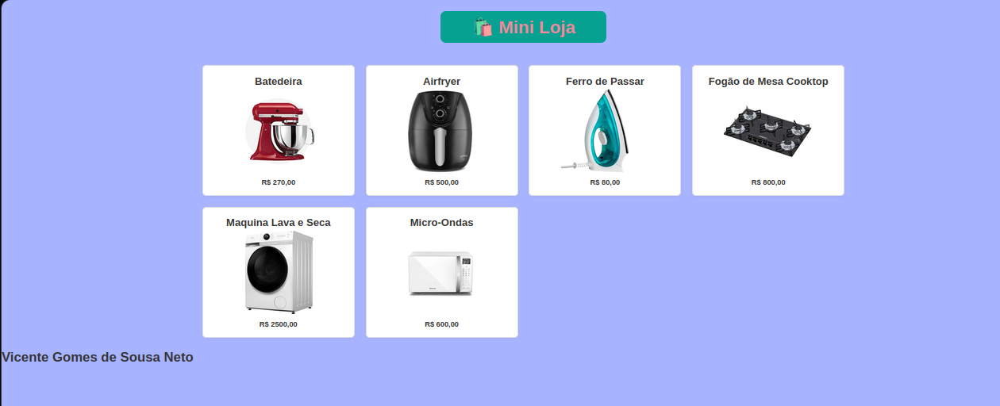
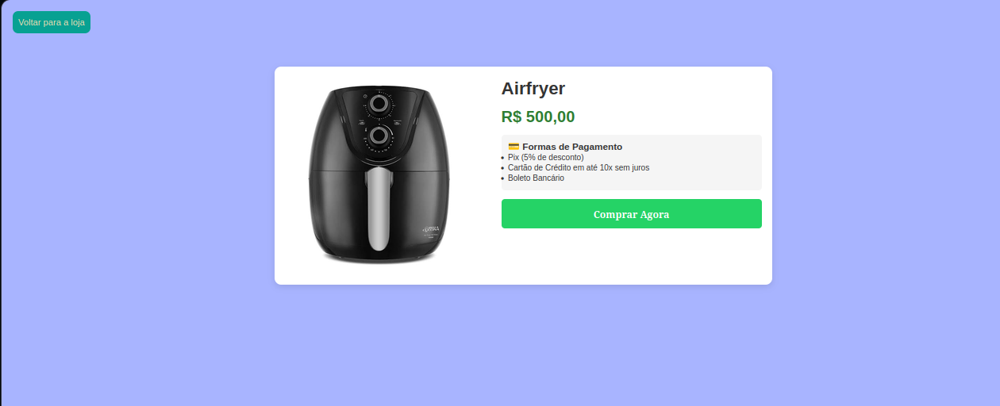

# 🛍️ Mini-Loja

## 🖌️ Design da Mini-Loja

### Home Page

### Detalhes do Produto

### Pop-up de Compra

## 💻 Sobre o Projeto
Esse projeto veio como um desafio proposto pelo programa Trilhas. No qual consiste em criar um site simples de compras de produtos. Nesse site eu pude implementar conceitos aprendidos nas aulas do trilhas, como por exemplo:

- Tags HTML: Nesse projeto temos uma tag `` que serve para mudar de página;
- Estilização com CSS: Nesse projeto nos utilizamos `class`,`id` ou a própria tag para referenciar cada componente do `index.html` que vamos estilizar no nosso `style.css`, por exemplo queremos estilizar a `class="produto"` no arquivo CSS nos chamamos essa classe da seguinte maneira: `.produto{ regras de estilização aqui}`. Foi a parte do nosso prójeto que teve mais linhas em um único arquivo;
- Lógica no JavaScript: Essa foi a parte onde eu particularmente mais encontrei dificuldades. Principalmente na parte de pegar elementos do HTML para trabalhar nas nossas variaveis sejam elas `let` ou `const`. Nos nossos arquivos `main.js` e `detalhes.js` nos utilizamos para montar a lógica por tras dos preços, descontos aplicados á forma de pagamento, estoque limitado, desconto aplicado aos 20 ultimos produtos e a dinamica da página principal, página de produto e pop-up de compra é toda controlada por JavaScript.

### Páginas do Projeto:
Esse projeto foi feito com mais do que foi pedido. Era pra ser uma página com `prompt()` para selecionar o produto e `alert()` para informar quando a compra foi realizada. Mas eu quis incrementar. Para me ajudar eu usei o Google Gemini para me guiar no desenvolvimento.

O projeto é composto por 2 páginas `index.html` e `produto.html`, a primeira página mostra todos os produtos e a segunda mostra apenas o produto que a pessoa clicar. Ao acessar a página `produto.html` a pessoa vai ter acesso ao preço, uma imagem mais nítida do produto, uma lista com as formas de pagamento e um botão de compra. Ao clicar no botão de compra aparece um pop-up que no código tem o nome de `modalChekout` ele não é uma página html. Ele é uma `

` que aparece somente quando voce apertar o botão de comprar. Por fim, a rota normal de compra é `index.html -> produto.html -> 

` se a compra for finalizada ela retorna pra `index.html` se não ela pode sair do pop-up, utilizar o botão de voltar e ir para a página principal escolher outro produto.

## 🚀 Funcionalidades

As principais funcionalidades desse projeto estão nos arquivos .js: `detalhes.js` e `main.js`. As funções do `main.js` são: 

- `iniciarHome()`: Função assíncrona executada na página inicial `index.html` responsável por gerenciar dinamicamente a vitrine de produtos. Ela sincroniza o catálogo externo `produtos.json` com o estado do navegador `localStorage`, ocultando itens esgotados e aplicando regras visuais de desconto e urgência para produtos com estoque baixo. Primeiramente ela realiza uma requisição assíncrona para buscar os dados oficiais em `src/produtos.json` e nisso ela lê o `localStorage` para recuperar a lista de produtos já comprados `produtosComprados` e o estado atual do inventário  `estoqueProdutos`. Utiliando o recurso do `forEach` ele faz uma varredura percorrendo todos os cards de produtos presentes na tela `.produto` com base no atributo `data-id`. Se o produto já foi totalmente comprado ou se o seu estoque local é menor ou igual a zero, o card é removido visualmente da vitrine `card.style.display = 'none'`. Mas também, Verifica se a quantidade atual do produto é de 20 unidades ou menos e caso a condição seja verdadeira, o sistema sanitiza o preço original, calcula um desconto automático de 33% e oculta o elemento de preço padrão `h5`. Cria ou atualiza um elemento de preço personalizado `.preco`, exibindo o valor original riscado em cinza e o novo preço promocional em destaque (verde).Insere dinamicamente um selo visual de urgência no card `"🔥 Últimas X unidades! (33% OFF)"`. Por fim, captura qualquer falha de carregamento ou requisição, registrando um log de erro no console do navegador para facilitar a depuração.

- `produtosNaTela()`:Este trecho de código é responsável por gerenciar a interatividade na vitrine da loja `index.html`. Ele escuta os cliques do usuário em qualquer card de produto e realiza o redirecionamento dinâmico para a página de detalhes, repassando o identificador único do item através da URL.Ela varre o documento HTML com `querySelectorAll` e captura todos os elementos que possuem a classe `.produto`,armazenando-os em uma lista `NodeList`.Quando o usuário clica em um produto, a função lê o atributo HTML `data-id` daquele elemento específico (por exemplo, batedeira ou airfryer). Por fim, altera a propriedade `window.location.href` do navegador para redirecionar o usuário para a página de detalhes `pages/produto.html`, injetando o ID capturado como um parâmetro de consulta na URL `?id=batedeira`.

As funções do arquivo `detalhes.js`:

- `carregarBancoDeDados()`: Função assíncrona responsável por buscar os dados do catálogo de produtos em um arquivo externo `produtos.json` e inicializar o sistema de controle de estoque local do navegador `localStorage`. Ela realiza uma requisição(`fetch`) para carregar o arquivo `produtos.json` e converte a resposta em um objeto JavaScript utilizáve `produtosDB`. Depois essa função faz o gerenciamento de persistencia no `LocalStorage` verificando se já existe uma chave chamada `estoqueProdutos` salva no navegador. Se não existir (primeiro acesso do usuário), ela percorre o banco de dados recém-carregado e inicializa o estoque local com a quantidade padrão de cada produto definida no JSON, salvando esses dados no `LocalStorage` após garantir que os dados e o estoque estão prontos na memória, ela chama a função seguinte passando o estado atual do estoque para continuar a renderização da página. Por fim ela está dentro de um bloco `try/catch` caso ocorra qualquer falha ao localizar ou baixar o arquivo JSON, o erro é capturado e exibido no console do desenvolvedor para facilitar o rastreamento de bugs.

- `iniciarLogicaDoProduto(estoqueLocal)`: Função principal responsável por gerenciar a renderização da página de detalhes do produto. Ela identifica qual item o usuário escolheu através da URL, valida se há estoque disponível, atualiza a interface com as informações visuais e aplica regras dinâmicas de preços e limites de compra. Para saber qual produto deve ser exibido ela utiliza uma função nátiva do JavaScript `URLSearchParams` para ler a barra de endereços e extrair o parâmetro `?id=...`, identificando qual produto deve ser exibido. Depois ela cruza o D obtido com o banco de dados `produtosDB` e o estoque atual `estoqueLocal`. Se o produto não for encontrado ou se o estoque estiver zerado `<= 0`, a interface é alterada para exibir "Produto Esgotado ou Indisponível" e o botão de compra `.btn-comprar` é ocultado. Por fim essa função preenche dinamicamente os elementos HTML da página com o nome, a imagem e o título da aba do navegador `document.title`. Mas também, ela verifica se o preço vai receber desconto se o estoque do produto está com vinte ou menos unidades e preenche dinamicamente a página de produtos com o preço promocional.Se a condição for verdadeira, o sistema calcula automaticamente um desconto de 33%, reescrevendo o HTML do preço para exibir o valor original riscado, o preço promocional em destaque (verde) e um aviso visual de urgência ("🔥 Últimas X unidades! (33% OFF)"). Outra verificação de segurança que impede o cliente comprar mais produtos do que o que tem no estoque está nessa função ela configura o o input de quantidade (`inputQtd.max`) com o valor exato do estoque disponível e define o valor inicial como 1, garantindo que o usuário não consiga selecionar mais itens do que os disponíveis. No final dessa função ela chama outra função `configurarModal(...)` , repassando os parâmetros necessários para ativar a interatividade do pop-up de checkout e o cálculo em tempo real da nota fiscal.

- `configurarModal(idProduto, produtoEncontrado, estoqueLocal)`: Função controladora principal responsável por gerenciar todo o comportamento interativo do pop-up de checkout (modal de finalização de compra). Ela centraliza os ouvintes de eventos da interface, controla a abertura e o fechamento do modal e executa a lógica de persistência quando a compra é confirmada. Faz o mapeamento dos principais elementos HTML do modal (botão de compra, botão de fechar, botão de confirmação, input de quantidade e select de pagamento). Gerencia a abertura `display: flex` ao clicar em comprar e o fechamento `display: none` ao cancelar ou fechar o modal. Por fim ela faz o decremento e mantem a persistencia dos dados. Ao confirmar a compra, captura a quantidade desejada, subtrai do estoque local `estoqueLocal` e atualiza o armazenamento do navegador.Se o estoque do produto zerar `<= 0`, o ID é adicionado automaticamente à lista de `produtosComprados`, fazendo-o sumir da vitrine da página inicial. Por fim, emite um alerta de sucesso e redireciona o usuário de volta para a home `index.html`.

- `extrairValorNumerico(precoString)`: Uma função utilitária `helper` projetada para sanitizar e converter o formato textual de preço da moeda brasileira (armazenado como `string = "R$ 270,00"`) em um número decimal puro (`float = 270.00`). Ela verifica se há uma variavel string. Se tiver `null` ou `""` vai retornar 0. Remove a cifra de texto `"R$"`, espaços em branco, substitui pontos de milhar e converte a vírgula decimal para ponto padrão do JavaScript `.replace(",", ".")`. Por fim, retorna o valor convertido através de `parseFloat()`, permitindo que o sistema realize operações matemáticas e cálculos de desconto sem erros de tipo. 

- `calcularNotaFiscal()`: Função reativa encarregada de recalcular os valores da Nota Fiscal em tempo real sempre que o usuário altera a quantidade de itens ou a forma de pagamento, aplicando regras de negócio condicionais de desconto. Ela funciona da seguinte forma: ela compara a quantidade desejada pelo usuário com o estoque máximo disponível. Se o usuário tentar comprar mais do que o permitido, um alerta é disparado e o input é travado no limite máximo. Se o usuario altera o número de produtos o subtotal da compra altera automaticamente, se o usuario escolhe o pagamento via pix o subtotal recebe um desconto de 5%. Se não aplica automaticamente 33% de desconto sobre o preço unitário oficial, independentemente da forma de pagamento escolhida. Se não o preço normal é multiplicado pela quantidade de itens comprados e o desconto decrementado do produto deve ser 0. Por fim ele altera dinamicamente todos os campos visuais da Nota Fiscal dentro do modal (nome do produto, preço unitário calculado, quantidade, descrição do desconto aplicado e o valor total final a pagar).

## 🛠️ Tecnologias Utilizadas

- HTML5: Estruturação semântica das páginas (Vitrine Principal, Página de Detalhes do Produto e Pop-up de Checkout).

- CSS3: Estilização visual, design responsivo e componentização de elementos de interface.

- JavaScript (ES6+): Lógica de programação assíncrona `async/await, fetch()`, manipulação avançada do DOM e aplicação de regras de negócio dinâmicas.

- JSON (JavaScript Object Notation): Armazenamento estruturado e externo do catálogo de produtos `produtos.json`, simulando uma fonte de dados de API.

- LocalStorage API: Gerenciamento de persistência de dados no navegador do cliente para controlar o estoque em tempo real `estoqueProdutos` e rastrear histórico de compras `produtosComprados`.

- Git & GitHub: Controle de versão do código-fonte e facilitação para o modelo de desenvolvimento open-source e colaborativo.

## 🔧 Como Rodar o Projeto

Siga os passos abaixo para clonar e executar o projeto na sua máquina:

1. Pré-requisitos

- Ter o Git instalado no seu computador.

- Ter o Visual Studio Code (VS Code) instalado.

- Instalar a extensão Live Server no VS Code (criada por Ritwick Dey).

2. Passo a Passo

- Clone o repositório:
Abra o seu terminal ou prompt de comando e execute o seguinte comando:

        git clone https://github.com/Vincent506/Mini-Loja.git

- Abra o projeto no VS Code:
Abra a pasta do projeto clonado utilizando o Visual Studio Code.

- Inicie com o Live Server: Na barra lateral do VS Code, abra o arquivo principal index.html. No canto inferior direito da janela do VS Code, clique no botão "Go Live" (fornecido pela extensão Live Server).O projeto abrirá automaticamente no seu navegador predefinido através de um servidor local (geralmente em [http://127.0.0.1:5500](http://127.0.0.1:5500)).
